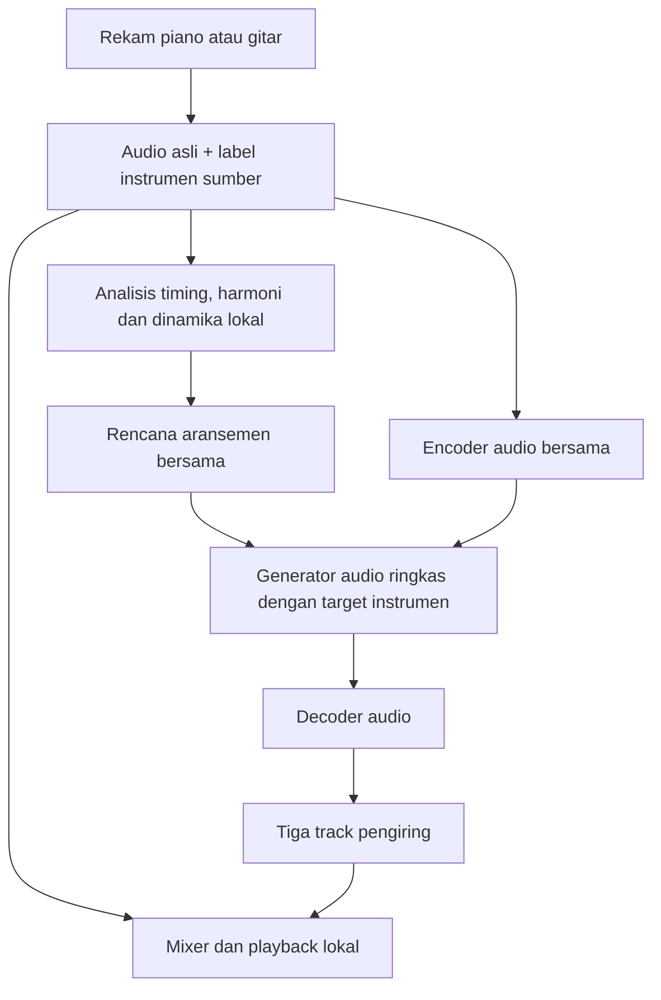

# Produk iPhone: iOS 27 / CoreAI / seluruh inferensi lokal

## Kebutuhan yang dikonfirmasi pengguna

- Target platform: iPhone dengan iOS 27, memakai **CoreAI** sesuai penamaan
  pengguna. Jangan menggantinya menjadi Core ML atau mengasumsikan API-nya sama.
- Perangkat uji awal: **iPhone 17 Pro**, deployment target **iOS 27.0**;
  hasil probe pertama melaporkan OS **27.0.1 build 24A446**.
- Pengguna melaporkan **Xcode 27.0 build 27A266a**, dengan SDK iphoneos27.0
  dan iphonesimulator27.0. Ini bukti ketersediaan toolchain dari terminal Mac
  pengguna, belum bukti bahwa modul CoreAI atau model audio sudah dapat dijalankan.
- Pengguna kemudian berhasil menjalankan type-check `import CoreAI` untuk
  `arm64-apple-ios27.0` dan melaporkan `CoreAI import: OK`. Impor modul pada
  target perangkat sudah dikonfirmasi melalui output pengguna; pemuatan model
  audio kustom dan konversi checkpoint belum diuji. Bukti perangkat berikutnya
  dicatat terpisah di bawah.
- ZIP interface SDK yang dikirim pengguna memperlihatkan bahwa `CoreAI`
  mengekspor ulang `CoreAIDelegates`.
- Pemindaian compiler berikutnya berhasil dan menemukan `CoreAIDelegates`,
  `CoreAIRuntime`, `CoreAICompiler`, `CoreAICommon` dan `CoreAIAsset` di
  `System/Library/SubFrameworks`. Laporan lokasi ini menggantikan pencarian
  sebelumnya yang kosong.
- Keenam interface kemudian berhasil dikirim. API `AIModel(contentsOf:options:)`,
  `InferenceFunction.run(inputs:)` dan `NDArray` tersedia sebagai deklarasi publik.
  SDK mendeklarasikan preferensi CPU/GPU/Neural Engine dan daftar compute kind
  yang tersedia. Penempatan model pada akselerator tertentu belum diuji.
  Format native `.aimodel` dan exporter coreai-torch kemudian diverifikasi untuk
  model numerik kecil; kompatibilitas ACE-Step tetap belum terverifikasi.
- Analisis, generasi audio pengiring, rendering dan mixing berjalan di perangkat.
  Tidak ada backend CUDA/server pada alur inferensi aplikasi final.
- Rekaman asli dipertahankan sebagai track sumber. Generate instrumen lain yang
  belum direkam; ini generasi pengiring, bukan ekstraksi stem dari sebuah mix.
- Piano direkam → generate gitar, bass dan drum.
- Gitar direkam → generate piano, bass dan drum.
- Hasil proyek: rekaman asli ditambah tiga track pengiring terpisah dan sinkron.

Kontrak ringkas yang dapat dibaca mesin ada di
`iphone-arrangement-requirements.json`. Scope sumber awal yang dikonfirmasi
adalah piano dan gitar; dukungan sumber bass/drum belum ditetapkan.

## Batas bukti saat ini

Repository ini masih bridge eksperimen Python/CUDA. Baseline bass/drum yang
tersimpan adalah referensi kualitas, bukan bukti bahwa model berjalan di iPhone.
Source Swift untuk probe runtime/tensor dan pemanggil model lokal kini tersedia
di [prototypes/ios27-coreai](../prototypes/ios27-coreai/README.md), beserta proyek
`CoreAIProbe.xcodeproj` dan shared scheme agar dapat langsung dibuka di Xcode.
Pengguna sudah melaporkan aplikasi berhasil berjalan di iPhone, arsitektur CoreAI
`h18p`, dengan **Float32 NDArray round-trip PASS**. CPU/GPU/Neural Engine
dilaporkan tersedia. Bukti dan batasnya ada pada [laporan perangkat](../reviews/coreai-iphone17pro-device-probe/README.md).
Model numerik native kemudian berhasil divalidasi, dimuat dan dijalankan dalam
3 run dengan error absolut 0. [Laporan inference](../reviews/coreai-iphone17pro-native-affine/README.md)
mencatat pemuatan sekitar 300 ms, run pertama 117 ms dan dua run hangat rata-rata
0,770 ms. Ini khusus model empat elemen, bukan estimasi waktu generasi audio.
Training mobile, konversi ACE-Step, benchmark audio dan penempatan akselerator
masih belum terverifikasi.

Impor modul CoreAI pada target iOS 27 sudah lolos di Mac pengguna. API pemuatan
aset dan eksekusi tensor telah diidentifikasi dari interface publik. Kontrak model
audio kustom, format export, operator serta performa/precision pada akselerator
perangkat masih perlu diuji. Interface CoreAICompiler yang dikirim tidak memiliki
fungsi compiler/export publik; jalur resmi sekarang ditetapkan melalui
coreai-torch dan coreai-build pada dokumentasi Apple, bukan dari interface itu.
CoreAI belum terbukti dapat langsung memuat checkpoint ACE-Step. Jika kemampuan
yang diperlukan tidak tersedia, laporkan blocker; jangan mengganti runtime diam-diam.

Uji paket legacy `.mlpackage` kemudian ditolak dengan `Missing hash file` saat
specialization, sebelum inference. Setelah perubahan jaringan, dokumentasi resmi
dapat dibaca: format sumber adalah `.aimodel` dan hasil AOT `.aimodelc`, yang
memperbaiki ejaan `.aimodels` sebelumnya. Ekspor native model numerik berhasil
dengan coreai-torch 0.4.3. Lihat [jalur resmi](coreai-native-export.md); inference
native model numerik pada iPhone kini dilaporkan lulus; tahap audio berikutnya
memerlukan verifikasi komponen, operator, memori dan kualitas tersendiri.

Pemeriksaan berikutnya tersedia pada `scripts/probe_coreai_sdk.sh`, dijalankan
di Mac dengan Xcode. Probe melakukan type-check `import CoreAI` untuk target
arm64-apple-ios27.0 dan menyalin interface publik yang ditemukan ke ZIP laporan.
Probe tidak memuat checkpoint, tidak menjalankan aplikasi di iPhone, dan tidak
menyimpulkan dukungan model audio hanya dari keberhasilan import. Lihat
[panduan probe SDK](coreai-sdk-probe.md).

## Rancangan yang diusulkan

1. **Sumber.** Pengguna memilih label piano/gitar saat merekam sebagai rancangan
   awal; tidak perlu mengandalkan classifier instrumen otomatis untuk routing.
   Simpan audio asli tanpa menimpanya dengan hasil generasi.
2. **Analisis bersama.** Ambil timing/onset, kandidat beat/chord, struktur dan
   dinamika dari sumber. Simpan confidence dan jangan menganggap BPM saja
   membuktikan birama/downbeat. Analisis chord yang salah dapat merusak semua
   instrumen, jadi perlu pengujian terpisah.
3. **Routing.** Pilih tiga target menurut instrumen sumber. Tidak menghasilkan
   ulang role yang sudah direkam. Skala awal: piano/gitar/bass/drum.
4. **Model.** Evaluasi satu model audio conditional multi-instrumen yang ringkas,
   dengan target-role conditioning dan encoder/decoder yang dapat dipakai
   bersama. Ini usulan untuk menghindari tiga salinan model besar; belum ada
   model ringkas terpilih atau klaim kualitas/performa.
5. **Koordinasi.** Semua target mengikuti rencana harmoni, groove, dinamika dan
   struktur yang sama. Menghasilkan tiga audio secara terpisah tanpa koordinasi
   tidak menjamin ketiganya cocok ketika dicampur.
6. **Eksekusi.** Evaluasi generasi berurutan dengan reuse bobot untuk mengendalikan
   peak RAM. Urutan dan keuntungan RAM/latensi perlu diukur. Tidak menjanjikan
   realtime; asumsi prototipe adalah rekam dahulu, kemudian generate.
7. **Lagu panjang.** Uji state/konteks antarbagiannya dan kontinuitas musikal.
   Pengalaman chunk bass membuktikan bahwa crossfade saja tidak menyelesaikan
   noise, perubahan timbre atau inkonsistensi groove di dalam hasil generasi.
8. **Playback.** Simpan tiga output sebagai audio terpisah dengan timeline yang
   sama dengan sumber; mixing/mute/volume dilakukan lokal. File model harus
   tersedia lokal sebelum generasi dimulai.

Pelatihan/distilasi dapat dikerjakan di GPU pengembangan; ini tidak memasukkan
server ke alur inferensi pengguna. Data pengembangan memerlukan contoh sumber
dan pengiring dengan timeline selaras, role instrumen yang benar, dan variasi
musik yang cukup. Distilasi/kuantisasi tidak otomatis mempertahankan kualitas
ACE-Step dan bukan sekadar mengubah ekstensi file checkpoint.

## Urutan validasi berikutnya

1. Verifikasi SDK CoreAI iOS 27 dan jalur model audio kustom pada toolchain Apple.
2. Tentukan model iPhone minimum, budget RAM, storage, waktu tunggu dan panas.
3. Buat spike audio pendek pada perangkat nyata sebelum memilih arsitektur dan
   menghabiskan training besar. Ukur seluruh encoder/generator/decoder.
4. Uji satu target instrumen, lalu tiga target bersama, termasuk konsistensi
   timing, harmoni, timbre, kualitas audio dan stabilitas numerik.
5. Baru uji seluruh lagu. Hasil CUDA/CoreAI tidak diasumsikan identik.

Pekerjaan drum full-song CUDA yang sedang dicoba tetap menjadi eksperimen
referensi. Belum ada perubahan pada preset atau baseline audio yang disetujui.
