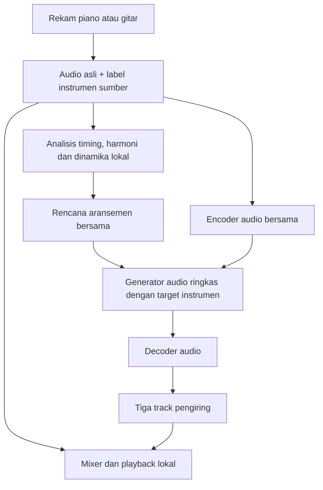

# Produk iPhone: iOS 27 / CoreAI / seluruh inferensi lokal

## Kebutuhan yang dikonfirmasi pengguna

- Target platform: iPhone dengan iOS 27, memakai **CoreAI** sesuai penamaan
  pengguna. Jangan menggantinya menjadi Core ML atau mengasumsikan API-nya sama.
- Analisis, generasi audio pengiring, rendering dan mixing berjalan di perangkat.
  Tidak ada backend CUDA/server pada alur inferensi aplikasi final.
- Rekaman asli dipertahankan sebagai track sumber. Generate instrumen lain yang
  belum direkam; ini generasi pengiring, bukan ekstraksi stem dari sebuah mix.
- Piano direkam → generate gitar, bass dan drum.
- Gitar direkam → generate piano, bass dan drum.
- Hasil proyek: rekaman asli ditambah tiga track pengiring terpisah dan sinkron.

Kontrak ringkas yang dapat dibaca mesin ada di
`iphone-arrangement-requirements.json`. Scope sumber awal yang dikonfirmasi
adalah piano dan gitar; dukungan sumber bass/drum belum ditetapkan.

## Batas bukti saat ini

Repository ini masih bridge eksperimen Python/CUDA. Baseline bass/drum yang
tersimpan adalah referensi kualitas, bukan bukti bahwa model berjalan di iPhone.
Belum ada aplikasi Swift, implementasi CoreAI, model hasil konversi, training
model mobile, atau benchmark iPhone di repository ini.

API SDK CoreAI iOS 27, dukungan model audio kustom, format impor/ekspor,
operator, precision, serta target akselerator belum diverifikasi di workspace
ini. Dokumen ini tidak mengarang nama kelas/API atau menyatakan bahwa CoreAI
bisa langsung memuat checkpoint ACE-Step. Kelayakan desain model bergantung pada
verifikasi kemampuan SDK tersebut. Jika kemampuan yang diperlukan tidak ada,
laporkan blocker; jangan mengganti runtime diam-diam.

## Rancangan yang diusulkan

1. **Sumber.** Pengguna memilih label piano/gitar saat merekam sebagai rancangan
   awal; tidak perlu mengandalkan classifier instrumen otomatis untuk routing.
   Simpan audio asli tanpa menimpanya dengan hasil generasi.
2. **Analisis bersama.** Ambil timing/onset, kandidat beat/chord, struktur dan
   dinamika dari sumber. Simpan confidence dan jangan menganggap BPM saja
   membuktikan birama/downbeat. Analisis chord yang salah dapat merusak semua
   instrumen, jadi perlu pengujian terpisah.
3. **Routing.** Pilih tiga target menurut instrumen sumber. Tidak menghasilkan
   ulang role yang sudah direkam. Skala awal: piano/gitar/bass/drum.
4. **Model.** Evaluasi satu model audio conditional multi-instrumen yang ringkas,
   dengan target-role conditioning dan encoder/decoder yang dapat dipakai
   bersama. Ini usulan untuk menghindari tiga salinan model besar; belum ada
   model ringkas terpilih atau klaim kualitas/performa.
5. **Koordinasi.** Semua target mengikuti rencana harmoni, groove, dinamika dan
   struktur yang sama. Menghasilkan tiga audio secara terpisah tanpa koordinasi
   tidak menjamin ketiganya cocok ketika dicampur.
6. **Eksekusi.** Evaluasi generasi berurutan dengan reuse bobot untuk mengendalikan
   peak RAM. Urutan dan keuntungan RAM/latensi perlu diukur. Tidak menjanjikan
   realtime; asumsi prototipe adalah rekam dahulu, kemudian generate.
7. **Lagu panjang.** Uji state/konteks antarbagiannya dan kontinuitas musikal.
   Pengalaman chunk bass membuktikan bahwa crossfade saja tidak menyelesaikan
   noise, perubahan timbre atau inkonsistensi groove di dalam hasil generasi.
8. **Playback.** Simpan tiga output sebagai audio terpisah dengan timeline yang
   sama dengan sumber; mixing/mute/volume dilakukan lokal. File model harus
   tersedia lokal sebelum generasi dimulai.

Pelatihan/distilasi dapat dikerjakan di GPU pengembangan; ini tidak memasukkan
server ke alur inferensi pengguna. Data pengembangan memerlukan contoh sumber
dan pengiring dengan timeline selaras, role instrumen yang benar, dan variasi
musik yang cukup. Distilasi/kuantisasi tidak otomatis mempertahankan kualitas
ACE-Step dan bukan sekadar mengubah ekstensi file checkpoint.

## Urutan validasi berikutnya

1. Verifikasi SDK CoreAI iOS 27 dan jalur model audio kustom pada toolchain Apple.
2. Tentukan model iPhone minimum, budget RAM, storage, waktu tunggu dan panas.
3. Buat spike audio pendek pada perangkat nyata sebelum memilih arsitektur dan
   menghabiskan training besar. Ukur seluruh encoder/generator/decoder.
4. Uji satu target instrumen, lalu tiga target bersama, termasuk konsistensi
   timing, harmoni, timbre, kualitas audio dan stabilitas numerik.
5. Baru uji seluruh lagu. Hasil CUDA/CoreAI tidak diasumsikan identik.

Pekerjaan drum full-song CUDA yang sedang dicoba tetap menjadi eksperimen
referensi. Belum ada perubahan pada preset atau baseline audio yang disetujui.
